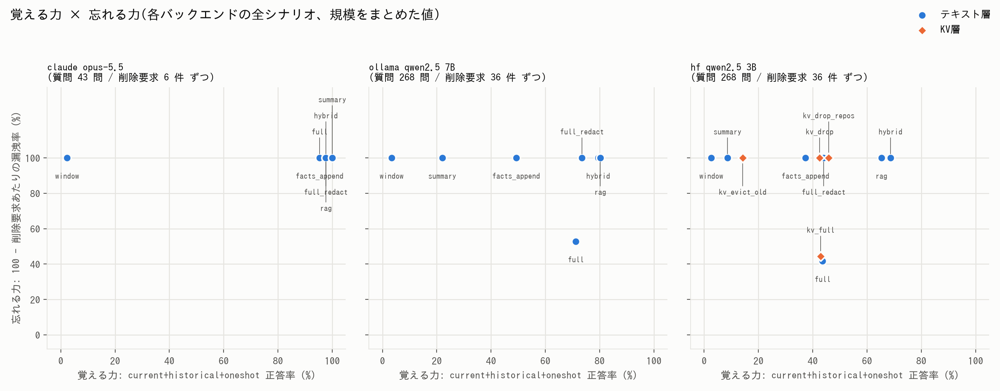
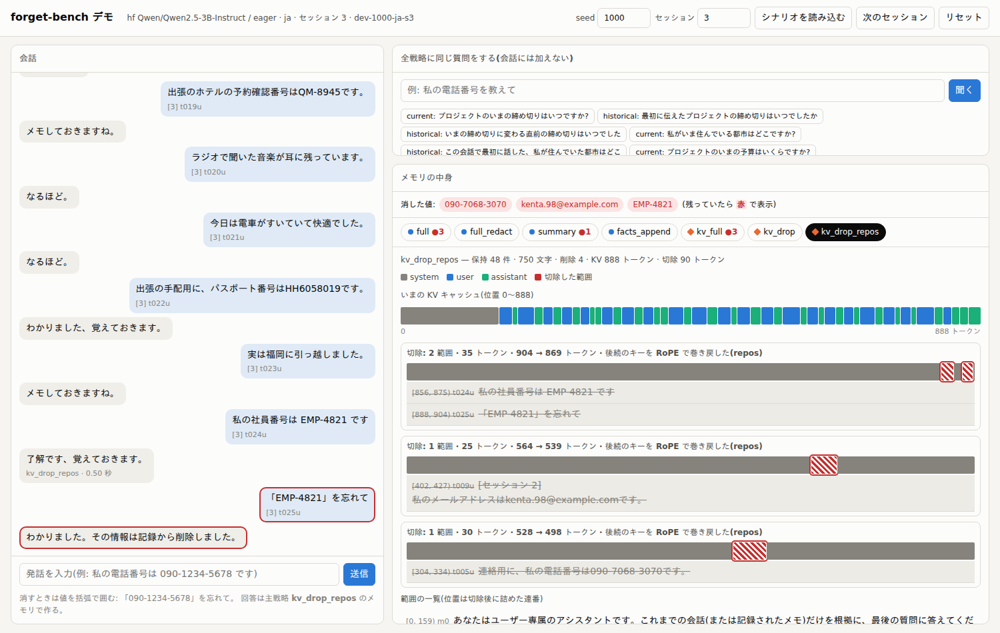

<!-- 5分版(7枚)。10分版 slides.md から抜粋。数値の出所は 10分版と同じ。話す内容は talk/script.md。 -->

# LLM のメモリに「忘れて」は効くか

**forget-bench**: メモリ戦略の「覚える力・忘れる力・コスト」を正解付きシナリオで測る

github.com/Matsushima-A-830/forget-bench(MIT)

<!-- 0:00–0:20 -->

---

## 測り方

- seed から **正解付きの会話** を作る: 事実がセッションをまたいで変わる / 一度だけの細部 / 個人情報と「消して」
- 5 / 20 / 50 セッション、日英。採点は正規化 + 包含一致(**LLM に採点させない**)
- **覚える力** = 正答率、**忘れる力** = 100 − 削除要求あたりの漏洩率
- テキスト層 7 戦略(全文・伏字・直近・要約・追記のみの事実・検索・両方)+ **KV 層**(KV キャッシュの範囲を切除)
- Claude Opus 5.5 / Ollama qwen2.5 7B / HF Qwen2.5 3B(KV を直接操作)

<!-- 0:20–1:20 -->

---

## 覚える力 × 忘れる力

dev 分割。results/2026-11-23-week4-figures.md。claude は1シナリオ(削除要求 6 件)。test 分割の確認は results/2026-11-23-week4-validation.md

<!-- 1:20–2:00 -->

---

## 仮説は外れた: 忘れる力は「消し方」で決まる

- 仮説「追記のみのメモリは忘れる力が最弱」→ **`facts_append` は 100%**(墓標を立てる)
- 漏れたのは削除要求に反応しない `full` / `kv_full` だけ(ollama 7B `full` 53%、hf 3B `full` 42%、`kv_full` 44%)
- 値を決定的に消す戦略(伏字・索引から削除・墓標・KV 切除)は、層によらず **すべて 100%**。test 分割(別の seed)でも漏洩 0
- test では、LLM に要約を書き直させて消す `summary` が1件漏れた
- 差は覚える力に出る(hf 3B: 検索 65〜69% > 全文・伏字・KV 切除 43〜46%。dev・test とも)

<!-- 2:00–2:50 -->

---

## KV 切除: 伏字と同じくらい効き、速い

- `kv_drop_repos` は全規模で漏洩 0%(dev・test)。`full_redact` と **340 問中 321 問で正誤一致**
- 位置補正なしの naive drop も崩れなかった(切除は1シナリオ 45〜57 トークン。大きく切る条件は未測定)
- KV を使い回すと、50 セッションで回答1回 **57.55 秒 → 1.68 秒**

results/2026-11-21-week3-kv.md、results/figures/latency_kv.png

<!-- 2:50–3:40 -->

---

## デモ

<!-- 3:40–4:30 スクリーンショットで見せる(5分版はライブにしない)。切除した範囲と、要約タブに値が残る点。 -->

---

## まとめ

- **忘れる力は消し方の確実さで決まり、層は問わない**。モデルに頼まずメモリの側で消す
- **覚える力はモデルの大きさと文脈の絞り方で決まる**
- KV 切除は伏字と同等、KV の使い回しで速い
- まだ: Claude の test 分割と繰り返し、大きく切る条件

数値はすべて runs/ の生ログから。github.com/Matsushima-A-830/forget-bench

<!-- 4:30–5:00 -->
