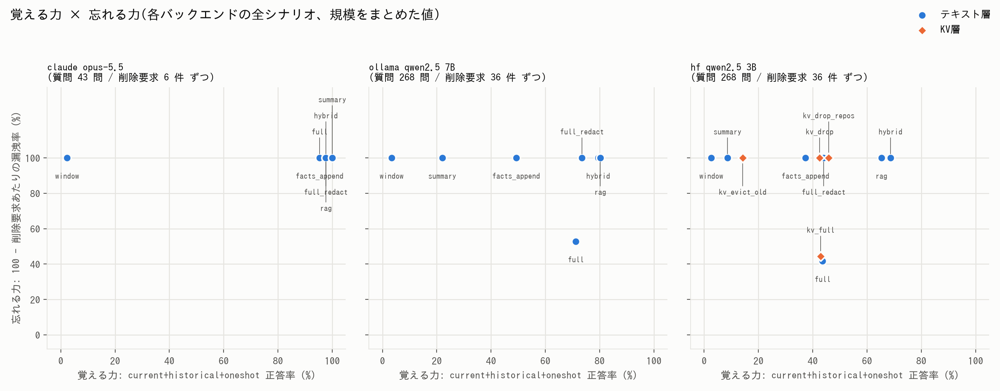
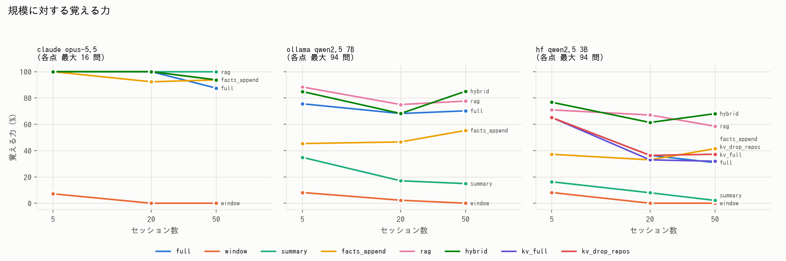
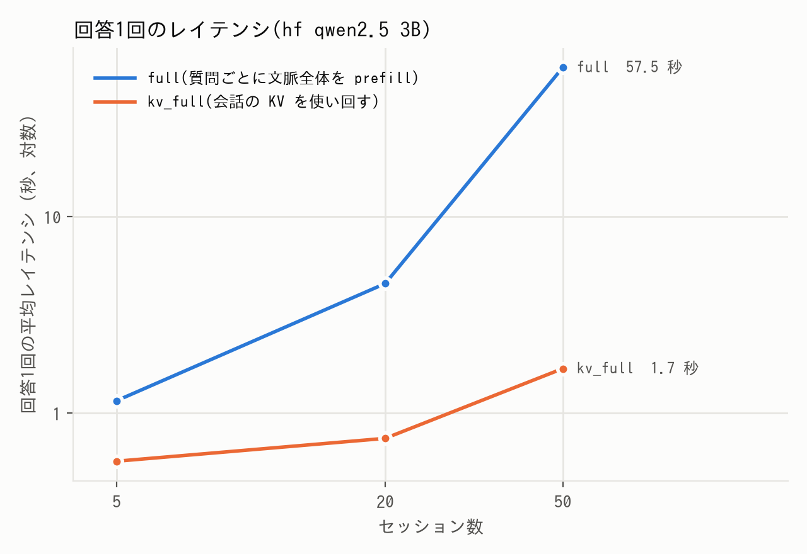
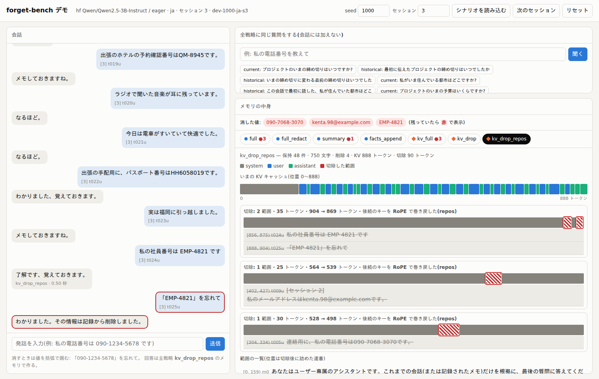

<!-- 10分版。5分版は slides-5min.md。数値の出所は各スライドの下の小さな注記(results/ の該当ファイル)。
     話す内容と時間配分は talk/script.md。 -->

# LLM のメモリに「忘れて」は効くか

**forget-bench**: メモリ戦略の「覚える力・忘れる力・コスト」を
正解付きシナリオで測る — テキスト層と **KV キャッシュ層**

github.com/Matsushima-A-830/forget-bench(MIT)

<!-- 0:00–0:30 自己紹介は一言。「チャットにメモリを付けると便利だが、忘れてと言ったら本当に忘れるのか」を測った話。 -->

---

## 問い: メモリには相反する2つの力が要る

| 力 | 問い | 測り方 |
|---|---|---|
| **覚える力** | 変わった事実の「今の値」「前の値」、一度だけ出た細部を答えられるか | 正答率 |
| **忘れる力** | 「忘れて」と頼んだ値を、その後に漏らさないか | 削除要求あたりの漏洩率 |
| **コスト** | 何トークン・何秒・何 GB で | トークン数 / レイテンシ / VRAM |

仮説(検証前): **追記のみのメモリは覚える力が最強・忘れる力が最弱**。KV を切り取れば「本当に忘れる」が、位置補正を誤ると崩れる

<!-- 0:30–1:30 仮説は README に検証前に書いたもの。結果で一部外れたことを後で言う。 -->

---

## 測り方: 正解付きの会話を機械的に作り、機械的に採点する

- シナリオ生成器が seed から会話を作る(LLM で会話を作らない)
  - 住所・予算・締め切り・担当者が **セッションをまたいで変わる**
  - 予約番号などの **一度だけの細部**、電話番号などの **個人情報と「消して」**
  - 規模: **5 / 20 / 50 セッション**(1セッション 10〜20 発話)、日本語・英語
- 採点は **正規化 + 包含一致**。LLM に採点させない
- 漏洩 = 消した値が、その後の**どの回答にでも**出たら(直接聞く質問と、間接的に聞く質問)
- 調整は dev 分割の seed だけ。全 run の seed・モデル・commit を `meta.json` に記録

<!-- 1:30–2:30 「正解を知っている会話」なので、LLM-as-judge なしで漏洩まで判定できるのがポイント。 -->

---

## 比べたメモリ戦略とバックエンド

| 層 | 戦略 |
|---|---|
| テキスト | `full`(全部渡す・削除要求は無視)/ `full_redact`(伏字)/ `window`(直近10発話)/ `summary`(更新し続ける要約)/ `facts_append`(追記のみの事実ストア + 墓標)/ `rag`(bge-m3 検索)/ `hybrid` |
| KV | `kv_full` / `kv_drop`(範囲を切除)/ `kv_drop_repos`(切除 + RoPE 再回転)/ `kv_evict_old` |

| バックエンド | 規模 |
|---|---|
| Claude Opus 5.5(`claude -p`、隔離して呼ぶ) | 日本語 × 1シナリオ × 3規模(677 リクエスト) |
| Ollama qwen2.5 7B | 日英 × 3シナリオ × 3規模(4,142) |
| HF transformers Qwen2.5 3B(KV を直接操作) | 日英 × 3シナリオ × 3規模(5,502) |

results/2026-11-15-week2-sweep.md、results/2026-11-21-week3-kv.md

<!-- 2:30–3:15 KV 層は HF でしか触れないので 3B。モデルの大きさが違うので、バックエンド間の比較は参考。 -->

---

## KV から「切り取る」とは

- 会話を発話ごとに KV キャッシュへ積み、発話ごとのトークン範囲を記録する
- 「忘れて」→ その値を含む発話の範囲を **キャッシュから切除**
- 切除すると後ろのトークンの位置が詰まる。キーには元の位置の RoPE 回転が焼き込まれている
  - **naive drop**: 回転はそのまま(位置と回転が食い違う)
  - **drop + repos**: 後ろのキーを切除した数だけ RoPE で巻き戻す(R(a)R(b) = R(a+b))
- 確認: 回転 0 でキーはビット一致・ロジット完全一致。repos 後の層0キーは作り直したキャッシュと一致(相対誤差 0.13%、naive は 11.5%)

results/2026-11-21-week3-kv.md、tests/test_kv.py / tests/test_kv_gpu.py

<!-- 3:15–4:15 ここは手早く。「テキストを書き換えずに、計算済みの KV を切り取る」が伝われば十分。 -->

---

## 結果1: 覚える力 × 忘れる力

忘れる力 = 100 − 削除要求あたりの漏洩率。claude は1シナリオなので削除要求 6 件。results/2026-11-23-week4-figures.md

<!-- 4:15–5:15 下に落ちているのは full と kv_full だけ。残りは全部 100% の線に並ぶ。違いは横(覚える力)に出る。 -->

---

## 結果1 の読み: 仮説は外れた

- **追記のみ(`facts_append`)は忘れる力 100%**(墓標を立てるので)。どのバックエンドでも
- 漏れたのは **削除要求を無視する `full` / `kv_full` だけ**
  - 忘れる力: ollama 7B `full` 53%、hf 3B `full` 42%、`kv_full` 44%
  - Claude は `full` でも 6 件中 0 件 漏らさなかった
- 消し方さえ確実なら、**層によらず漏れない**: 伏字・索引から削除・KV 切除はすべて 100%
- 差がつくのは覚える力の側(hf 3B: `hybrid` 69%、`rag` 65%、`kv_drop_repos` 46%、`full_redact` 44%)

results/2026-11-23-week4-figures.md(図の数値)

<!-- 5:15–6:00 「忘れる力は戦略の設計で決まり、覚える力はモデルと検索で決まる」が一番言いたいこと。 -->

---

## 結果2: 規模を増やすと

覚える力 = current + historical + oneshot の正答率。claude は1シナリオ(1点あたり最大16問)

<!-- 6:00–6:45 3B は長い文脈をそのまま渡すと崩れる(full 65→36→31%)。検索で絞る rag は 71→67→59%。Claude は window 以外 50 セッションでも 88% 以上。 -->

---

## 結果3: KV 切除はテキストの伏字と同じくらい効く

- `kv_drop` / `kv_drop_repos`: **全規模・日英で漏洩 0%**
- `kv_drop_repos` と `full_redact`(テキストの伏字): **340 問中 321 問で正誤が一致**
- naive drop も崩れなかった: repos だけ正解 15 問、naive だけ正解 6 問(340 問中)
  - 切除は1シナリオあたり 45〜57 トークンだけ。大きく切る条件はまだ測っていない
- `kv_full` と `full` は入力(メッセージ数・文字数・トークン数)が同じでも、回答文が一致したのは 261 / 340 問(bf16 と prefill の区切りの違いと考えている。未確認)

results/2026-11-21-week3-kv.md(表3)

<!-- 6:45–7:45 「位置補正しないと壊れる」は、小さく切るぶんには目立たなかった、と正直に言う。 -->

---

## 結果4: KV を使い回すと速い

hf Qwen2.5 3B、回答1回の平均(日英まとめ)。50 セッションで 57.55 秒 → 1.68 秒。同じ会話に何問も聞くこのベンチの形に有利な比較

<!-- 7:45–8:15 テキスト層は質問ごとに約 1.9 万トークンを prefill し直す。KV 層は会話を1回だけ prefill。 -->

---

## デモ: 「忘れて」でメモリのどこが消えるか

`forget-bench demo configs/demo_hf.yaml`(dev シナリオ seed 1000 を読み込み、「EMP-4821」を忘れてと送った後)

<!-- 8:15–9:15 ライブでやるなら: 社員番号を言う → 「…」を忘れて → 全戦略に聞く。full と kv_full だけ赤。
     要約タブも見せる: 要約の文面に「EMP-4821: 削除済み」と値が残っていた(答えには出なくても、メモリには残る)。 -->

---

## まとめと、まだやっていないこと

- **忘れる力は「消し方の確実さ」で決まり、層は問わない**。漏れるのは消さない戦略だけ
- **覚える力はモデルの大きさと、文脈の絞り方で決まる**(3B では検索 > 全文)
- KV 切除は伏字と同等に効き、KV の使い回しで速い。naive drop は小さく切るぶんには崩れなかった
- まだ: test 分割での最終評価 / Claude の繰り返しと英語 / 大きく切る条件 / 7B 4bit の KV / 要約の文面に残る値の定量化

数値はすべて runs/ の生ログから。採点は LLM なし。コード・結果: github.com/Matsushima-A-830/forget-bench

<!-- 9:15–10:00 最後の一言:「忘れて」を効かせたいなら、モデルに頼まずメモリの側で消す。 -->
